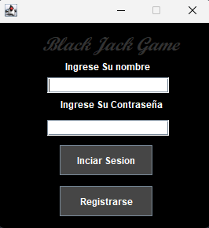
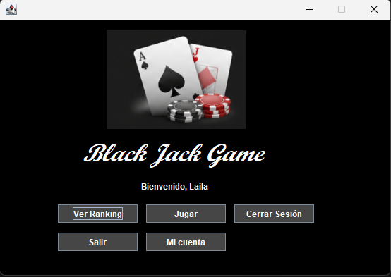
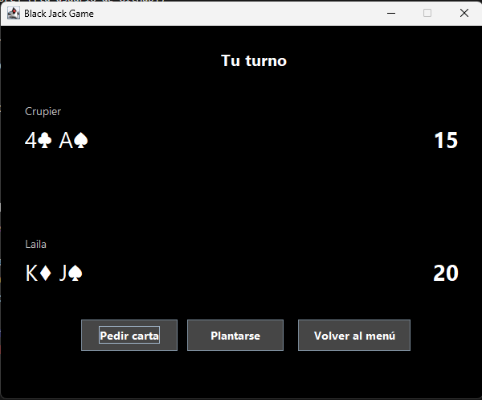
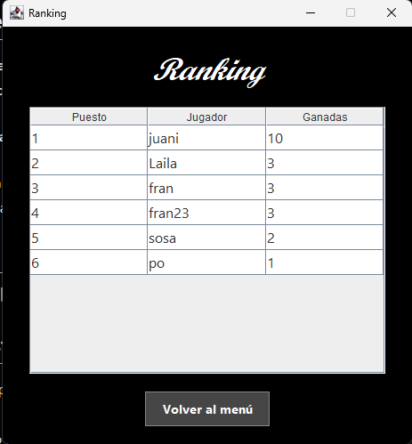

# BlackJack en Java 🃏

Proyecto que hicimos para la materia programacion orientada a objetos. este proyecto se trata de un juego de BlackJack de escritorio hecho en Java con Swing, con usuarios, base de datos y ranking.

La idea era practicar MVC, los pilares de POO y el manejo de una base de datos, así que más que un juego súper completo es un proyecto para aprender cómo se arma un programa ordenado de punta a punta.

## Qué se puede hacer

- **Registrarse e iniciar sesión.** Las contraseñas no se guardan tal cual: se guarda su hash (SHA-256).
- **Jugar al BlackJack contra el crupier.** Se reparten 2 cartas a cada uno, podés pedir carta o plantarte, y el crupier pide hasta tener 17 o más. El As vale 11 o 1 según convenga.
- **Rachas de partidas ganadas.** Cada mano que ganás suma 1. Después de ganar elegís: seguir jugando y arriesgar la racha, o retirarte y guardarla. Si perdés, perdés todo lo acumulado.
- **Ranking** con los 10 jugadores con más partidas ganadas guardadas.
- **Mi cuenta:** cambiar el nombre, cambiar la contraseña o eliminar la cuenta (ABM completo).

## Capturas

## Con qué está hecho

- Java (Swing para las ventanas)
- NetBeans
- SQLite como base de datos (con el driver `sqlite-jdbc`)

## Cómo está organizado

Seguimos el patrón **MVC**, más una capa aparte para la base de datos:

| Paquete | Qué tiene |
| --- | --- |
| `modelo` | Las reglas del juego: `carta`, `mazo`, `mano`, `participante`, `crupier`, `jugadorMesa` y `jugador` |
| `vista` | Las pantallas: login, registro, menú, juego, ranking y mi cuenta |
| `controlador` | Un controlador por pantalla, que conecta la vista con el modelo |
| `baseDatos` | La conexión (singleton) y los DAO, que son los únicos que tienen SQL |
| `util` | `hashContra`, para hashear las contraseñas |

Algunas cosas de POO que usamos:

- **Herencia:** `crupier` y `jugadorMesa` heredan de `participante` (la mano, recibir cartas, sumar puntos).
- **Polimorfismo:** `debePedirCarta()` es el mismo método en los dos, pero el crupier pide con menos de 17 y el jugador con menos de 21.
- **Encapsulamiento:** los atributos son privados y se usan con getters.
- **Abstracción:** `participante` es una clase abstracta.
